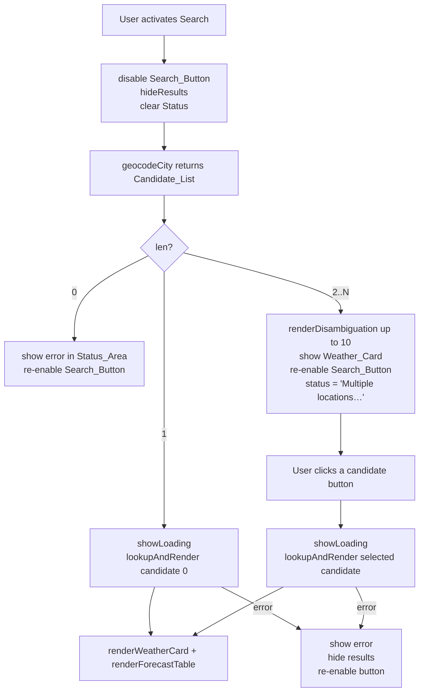

# Design Document: City Disambiguation

## Overview

The city-disambiguation feature extends `weather.js` to handle ambiguous city name input. Currently `geocodeCity()` discards all Nominatim results except the first. This change makes it return the full result array so `handleSearch()` can branch on three cases: zero results (error), one result (proceed automatically), or multiple results (show a selection UI before fetching weather).

All changes are confined to `weather.js` and optionally a small CSS addition to `index.html`. No new files, dependencies, build tools, or server-side code are needed.

---

## Architecture

The existing code already has a clean three-step chain:

```
User input → geocodeCity() → handleSearch() branches → NWS lookup → render
```

This feature inserts a decision point after the geocoding step:

```
User input
  → geocodeCity()          returns Candidate_List (full array)
  → handleSearch() branches
      0 results  →  error message, stop
      1 result   →  proceed to lookupAndRender(candidate)
      2–10+ results → renderDisambiguation(candidates)
                         User clicks a button
                         → lookupAndRender(candidate)
```

A new helper `lookupAndRender(candidate)` extracts the shared NWS-lookup-and-render path that both branches need, eliminating duplication.



---

## Components and Interfaces

### Modified: `geocodeCity(cityName)`

**Current behaviour**: returns `{ lat, lon, displayName }` for `results[0]` only; throws if empty.

**New behaviour**: returns the raw Nominatim result array (may be empty). The function no longer throws on zero results — it delegates that decision to the caller.

```
geocodeCity(cityName: string) → Promise<Array<{lat, lon, display_name, ...}>>
```

Concretely, the last ~five lines change from:

```js
// BEFORE
if (!results || results.length === 0) {
  throw new Error("City not found. Please try a valid US city name.");
}
const { lat, lon, display_name: displayName } = results[0];
return { lat, lon, displayName };
```

to:

```js
// AFTER
return results || [];
```

### New helper: `lookupAndRender(candidate, displayName)`

Shared NWS lookup path called from both the single-result branch and after a disambiguation selection.

```
lookupAndRender(candidate: {lat, lon, display_name}) → Promise<void>
```

Steps:
1. `showLoading()` — sets status to "Fetching weather data…", disables Search_Button.
2. Hides Weather_Card content (clears disambiguation HTML if present).
3. Calls `fetchPoints(candidate.lat, candidate.lon)`.
4. Calls `Promise.all([fetchCurrentConditions(stationsUrl), fetchForecast(forecastUrl)])`.
5. On success: `setStatus("")`, `renderWeatherCard(candidate.display_name, obs)`, `renderForecastTable(periods)`.
6. On error: `setStatus(err.message, true)`, `hideResults()`, logs `{url, status, message}` to console.
7. `finally`: re-enables Search_Button.

### New function: `renderDisambiguation(candidates)`

Renders the Disambiguation_UI inside `#weather-card`.

```
renderDisambiguation(candidates: Array<{lat, lon, display_name}>) → void
```

Steps:
1. Slices `candidates` to at most 10.
2. Builds an HTML fragment: a `<p>` heading and one `<button>` per candidate, each showing `candidate.display_name`.
3. Attaches a click handler to each button that calls `lookupAndRender(candidate)`.
4. Sets `#weather-card innerHTML` to the fragment, sets `#weather-card style.display = "block"`.
5. Sets `#forecast-table style.display = "none"` (hides any stale forecast).
6. Re-enables Search_Button (user can abandon and search again).
7. Sets status to `"Multiple locations found. Please select one:"`.

### Modified: `handleSearch()`

Replaces the current single-path logic with branching on `candidates.length`:

```
handleSearch() → Promise<void>
```

```
1. Read and trim city-input value.
2. If empty → setStatus error, return early.
3. disable Search_Button, hideResults(), setStatus("").
4. candidates = await geocodeCity(cityName)   [now returns full array]
5. if candidates.length === 0 → setStatus("City not found…", true), re-enable button, return.
6. if candidates.length === 1 → await lookupAndRender(candidates[0]).
7. else → renderDisambiguation(candidates).
   (lookupAndRender is called later via button click handler)
```

The `finally` block in `lookupAndRender` handles re-enabling the button for branches 5 and 6; branch 7 re-enables the button inside `renderDisambiguation` itself.

---

## Data Models

No new persistent state is introduced. The feature uses the same existing global state variables (`currentObs`, `currentUnit`, `currentForecastPeriods`).

**Candidate object** (Nominatim response element, used in-memory only):

| Field          | Type   | Source      | Usage                              |
|----------------|--------|-------------|------------------------------------|
| `lat`          | string | Nominatim   | Passed to `fetchPoints()`          |
| `lon`          | string | Nominatim   | Passed to `fetchPoints()`          |
| `display_name` | string | Nominatim   | Shown in disambiguation UI and Weather_Card city name |

No serialisation, no localStorage, no caching.

---

## Correctness Properties

*A property is a characteristic or behavior that should hold true across all valid executions of a system — essentially, a formal statement about what the system should do. Properties serve as the bridge between human-readable specifications and machine-verifiable correctness guarantees.*

### Property 1: `geocodeCity` returns the full candidate array

*For any* non-empty city name string, `geocodeCity()` SHALL return the complete array of Nominatim results without truncation, including when the array has zero, one, or many elements.

**Validates: Requirements 1.1**

---

### Property 2: Disambiguation UI invariants

*For any* Candidate_List with two or more entries, after `renderDisambiguation()` runs, the Weather_Card SHALL be visible (`display !== "none"`), the Forecast_Table SHALL be hidden (`display === "none"`), and the Search_Button SHALL be enabled (`disabled === false`).

**Validates: Requirements 3.1, 3.4, 3.5**

---

### Property 3: Button count equals `min(candidates.length, 10)`

*For any* Candidate_List of length N (N ≥ 1), `renderDisambiguation()` SHALL render exactly `min(N, 10)` clickable buttons, each displaying the `display_name` of the corresponding candidate at that index.

**Validates: Requirements 3.2**

---

### Property 4: Disambiguation status message is always the fixed string

*For any* Candidate_List with two or more entries, after `renderDisambiguation()` runs, the Status_Area SHALL contain exactly the text `"Multiple locations found. Please select one:"`.

**Validates: Requirements 3.3**

---

### Property 5: Candidate selection uses the correct coordinates and transitions to loading

*For any* Candidate_List and *for any* index i in `[0, min(N, 10))`, clicking the button for candidate i SHALL invoke the NWS lookup with `candidates[i].lat` and `candidates[i].lon`, and SHALL set the status to the loading message with the Search_Button disabled before the NWS request completes.

**Validates: Requirements 4.1, 4.2**

---

### Property 6: `display_name` round-trip to Weather_Card

*For any* candidate (reached via either the single-result or post-selection path), after a successful weather retrieval, the city name displayed in `#result-city` SHALL equal that candidate's `display_name` exactly.

**Validates: Requirements 2.2, 4.3**

---

### Property 7: Search_Button is always re-enabled after `handleSearch` settles

*For any* combination of geocoding outcome (0, 1, or many results) and NWS outcome (success or failure), once `handleSearch()` has fully settled, `#search-btn.disabled` SHALL be `false`.

**Validates: Requirements 5.1**

---

## Error Handling

| Scenario | Status_Area message | Weather_Card | Forecast_Table | Search_Button |
|---|---|---|---|---|
| Geocoder network failure | "Location lookup failed: network error." | hidden | hidden | re-enabled |
| Zero geocoder results | "City not found. Please try a valid US city name." | hidden | hidden | re-enabled |
| NWS failure (single result) | NWS error message | hidden | hidden | re-enabled |
| NWS failure after selection | NWS error message | hidden | hidden | re-enabled |
| Multiple results | "Multiple locations found. Please select one:" | visible (disambiguation) | hidden | re-enabled |

All NWS errors log `{ url, status, message }` to `console.error`, matching the existing convention established in `fetchNWS()`.

New search while disambiguation is visible: `handleSearch()` calls `hideResults()` before the geocoder request, which sets `#weather-card display = "none"`, clearing the disambiguation UI naturally.

---

## Testing Strategy

The existing test files in `tests/` use a lightweight plain-JS pattern: they mock browser globals (`document`, `fetch`, `console`) in a Node.js script, `require`/load `weather.js`, and assert outcomes. No test framework is installed; assertions use `if`/`throw`.

### Unit tests (example-based)

Cover the specific edge cases that fall outside the property tests:

- Zero geocoder results → error shown, NWS never called.
- Geocoder network error → error shown.
- NWS failure after disambiguation selection → error shown, card hidden, button re-enabled.
- New search while disambiguation is visible → card hidden before geocoder called.

### Property-based tests

The feature is well-suited to property-based testing because:
- `renderDisambiguation()` is a pure DOM-manipulation function whose output depends entirely on the input array.
- `geocodeCity()` has clear input/output behavior independent of its length.
- The selection→NWS data-flow is deterministic across all candidate objects.

**Library**: [`fast-check`](https://github.com/dubzzz/fast-check) (pure JS, works with Node.js without a build step).

Each property test runs a minimum of **100 iterations**. Tag format: `// Feature: city-disambiguation, Property N: <property text>`.

| Property | Test file | Generator |
|---|---|---|
| P1: full array returned | `tests/property-p1-geocode-full-array.js` | `fc.array(fc.record({lat: fc.float(), lon: fc.float(), display_name: fc.string()}))` |
| P2: disambiguation UI invariants | `tests/property-p2-disambig-ui-invariants.js` | `fc.array(..., {minLength: 2})` |
| P3: button count = min(N, 10) | `tests/property-p3-button-count.js` | `fc.array(..., {minLength: 1, maxLength: 15})` |
| P4: status message string | `tests/property-p4-status-message.js` | `fc.array(..., {minLength: 2})` |
| P5: selection uses correct coords | `tests/property-p5-selection-coords.js` | `fc.array(..., {minLength: 2})` + `fc.nat()` for index |
| P6: display_name round-trip | `tests/property-p6-display-name-roundtrip.js` | `fc.record({lat, lon, display_name: fc.string()})` |
| P7: button always re-enabled | `tests/property-p7-button-reenabled.js` | `fc.oneof(fc.constant([]), fc.array(..., {minLength: 1}))` |

Properties P2–P4 test `renderDisambiguation()` in isolation with a minimal DOM mock, so they are fast pure-function tests with no network involvement.

Properties P5–P7 test `lookupAndRender()` and `handleSearch()` with a mocked `fetch`, so they also run entirely in memory at low cost.
